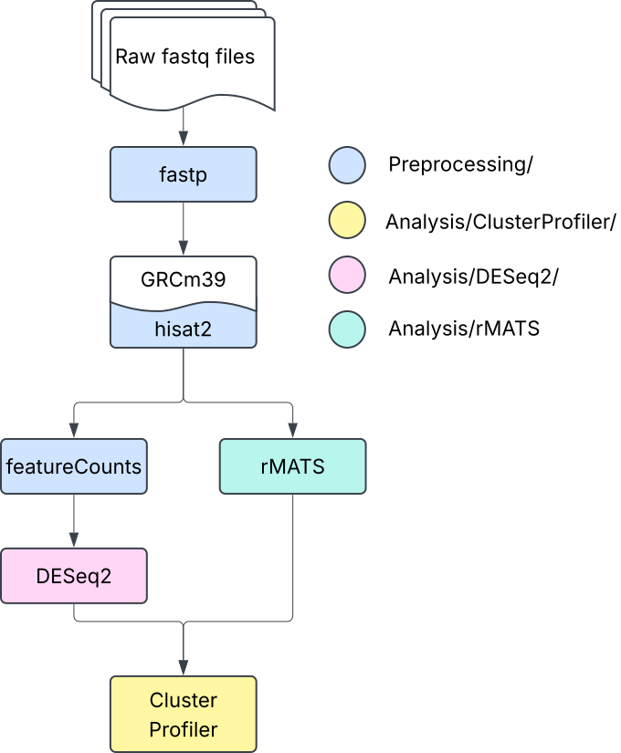

# Increased Inhibitory Synapse Formation in Kabuki Syndrome RNAseq
Code repository for "Human Neuron and Mouse Models Reveal Synaptic Imbalance in Kabuki Syndrome". Contains preprocessing of RNAseq data, differential gene expression analysis, functional enrichment analysis, and alternative splicing analysis.

All associated RNA-seq data (raw fastq and processed count tables) are available via the gene expression omnibus under accession ID:GSE330030.

## Citation
Any code or data resuse should cite
[insert citation when published]

# Workflow and Version Information
## Workflow


## Versions
### Preprocessing
* fastp v0.24.4
* hisat2 v2.1.0
* featurecounts (subread v2.0.1)

### Analysis
* R Version Information: All package versions are reported in the knitted markdown html files.
* rMATS-turbo v4.3.0

# Recommended directory structure

```text
Working_Directory/
├── docs/
├── scripts/
├── input/
└── results/
    ├── Experiment1/
    └── Experiment2/
```
